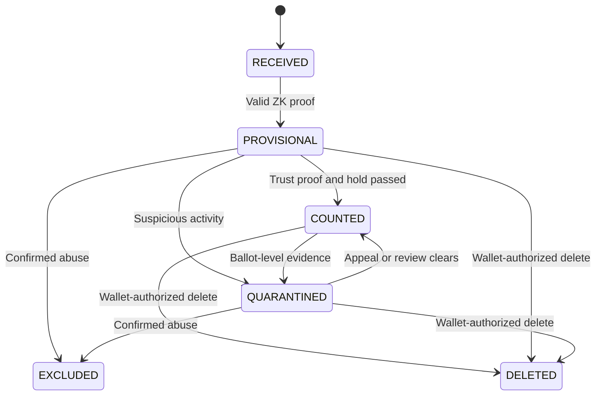
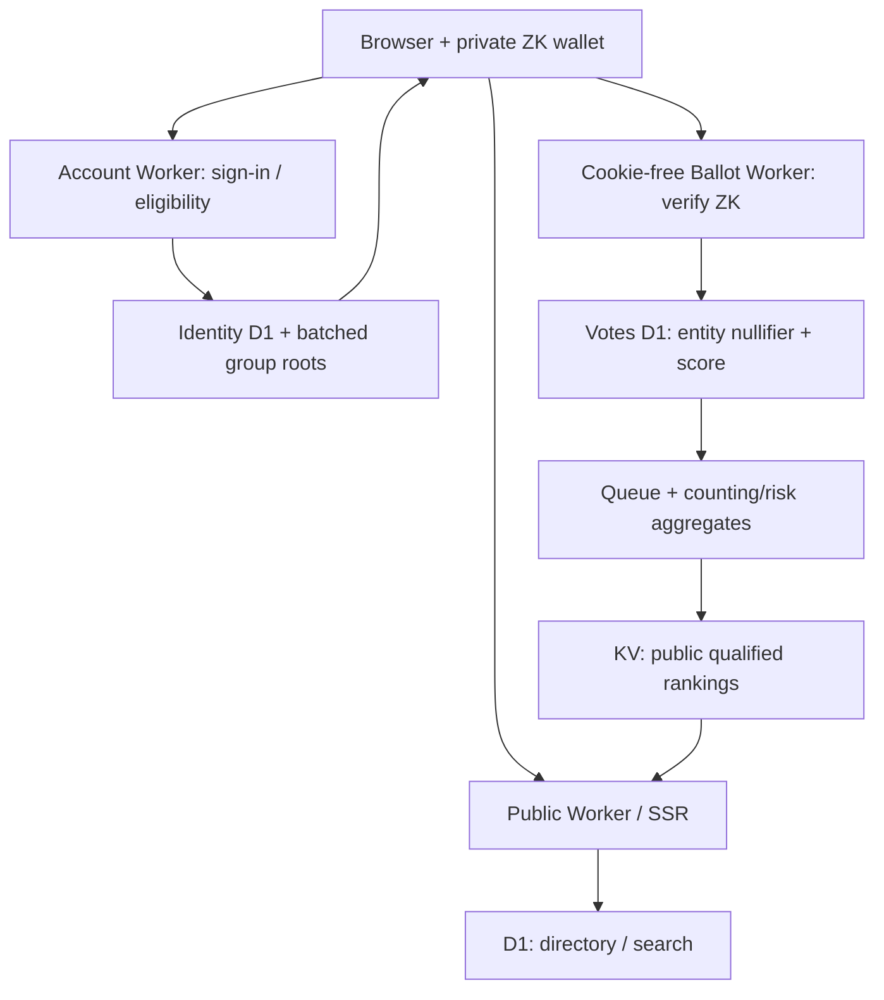

# GovZones — Government Agency Rating & Ranking Platform

**Technical and Product Specifications — v1.2 (Official branding: GovZones)**  
**Date:** 31 October 2026  
**Launch market:** Philippines (nationwide)  
**Architecture:** Cloudflare-first; country-aware for international rollout  
**Official product name:** GovZones  
**Primary domain:** [GovZones.com](https://govzones.com) (owned by the product owner; DNS/deployment not yet configured for this application)  
**Status:** Specification only — no implementation authorized or started

## 1. Executive summary

**GovZones** is an independent, mobile-first public platform where people search for government agencies and offices, sign in, and give a **single numeric score from 1 to 10**. Use **zero-knowledge group-membership proofs** so the ballot collector can verify voting eligibility **without learning which signed-in account submitted a score**. The service publishes transparent best-rated and worst-rated rankings, initially for the whole Philippines. It must distinguish parent agencies from their branches, resist rating manipulation, accept but exclude troll/suspected-fraud ballots from published scores, and support international expansion.

**Positioning:** “Government offices, rated by the people.” This is an independent public feedback website, **not** an official government service, endorsement, or statistical survey. **GovZones** is a civic rating brand, not a government organization or domain.

### Official branding and URL plan

| Surface | Proposed host / URL | Purpose |
| --- | --- | --- |
| Public site | `https://govzones.com` | Global entry; Philippines is default at launch |
| Philippines homepage | `https://govzones.com/ph` | Search and best/worst rankings |
| Future countries | `https://govzones.com/{country-code}` | Country-isolated directory and rankings |
| Account and enrollment | `https://accounts.govzones.com` | OAuth and wallet enrollment; host-only session cookies |
| Anonymous ballot service | `https://vote.govzones.com` | **Cookie-free**, independently authorized ZK ballot submissions |
| Internal administration | `https://admin.govzones.com` | Restricted by Cloudflare Access + MFA; not public |

The `/` entry point should open the Philippines experience during launch, with a visible country selector. Do not rely on IP geolocation to force country redirects. All listed subdomains are **planned routes**, not existing deployments.

### Non-negotiable product rules

1. Anyone can browse, search, filter, and view rankings **without signing in**.
2. A person must **sign in to enroll/unlock their private voting credential**; the subsequent ballot is cast through a **cookie-free anonymous endpoint**, never authenticated with their login session.
3. The only rating input is an **integer from 1 (lowest) to 10 (highest)**. No half-points, stars, written reviews, photographs, or comment threads in the MVP.
4. Each eligible cryptographic identity has **one active score per ratable entity**. One enrolled identity commitment per sign-in account is enforced at enrollment; a new score replaces the existing anonymous ballot, never adds another vote.
5. Public profiles, voter names, avatar images, and “who rated this” lists do not exist.
6. The homepage prominently shows **Best Rated** and **Lowest Rated**, with qualification rules and visible vote counts.
7. The app must be usable at **320 CSS pixels wide**, with no horizontal page scrolling or left/right layout shifting.
8. Deploy app, APIs, storage, security controls, and background processing on Cloudflare; external identity providers may be used for sign-in.
9. Every record is tied to a country; the Philippines is the default country at launch.
10. Agencies cannot buy rankings, alter their scores, or see voter identities.
11. **Option B is mandatory:** no account ID, provider subject, account-derived HMAC tag, or account-to-rated-entity index may exist in the ballot database or be passed to the ballot service.
12. **Troll-filtering is mandatory:** submit-only or suspicious ballots can be accepted and stored without affecting public averages, vote counts, best/worst lists, or exported aggregates. The system must never claim every received rating is counted.

## 2. Mandatory cryptographic anonymity (Option B)

### 2.1 Exact guarantee and threat model

**Target cryptographic property:** The ballot validator verifies **“some eligible group member submitted this signed-off score”**, but the proof reveals **neither the member's identity commitment nor which Google/Apple account enrolled it**. Ballots for different agencies must not share a stable identifier. Even an administrator with access to both the identity and ballot **databases** must not be able to join them through a stored key.

Use **Semaphore v4 (or a comparably audited, independently reviewed anonymous-credential protocol)**, in an **off-chain** deployment; no cryptocurrency, blockchain wallet, gas fees, or smart contracts are required. Semaphore supports zero-knowledge group membership, a public *scope*, and a deterministic *nullifier* computed from the private identity and that scope. That combination supports anonymous voting and uniqueness enforcement.

**Honest limitation:** Cryptography protects ballot/account linkage at the application-data layer, **not against every active or metadata attack**. A site operator that serves malicious JavaScript could try to steal client-side secrets; Cloudflare/network intermediaries may see IPs/times; very small anonymity groups or uniquely timed signup-vote patterns can reveal information. Release claims must read **“cryptographically unlinkable by the ballot protocol, subject to client, metadata, and anonymity-set limitations”**—never “impossible to trace under any circumstances.” Independent security and privacy review is a launch gate.

### 2.2 Enrollment: sign-in only establishes group membership

1. User signs in with Google or Apple to the **Account/Eligibility Worker** (OAuth state, nonce, PKCE where applicable, token validation). Identity D1 stores only the minimum protected provider subject needed to enforce one **enrolled commitment per provider account**; do not retain profile names, images, or email unless strictly required.
2. Browser generates a **cryptographically random private Semaphore identity** using an audited library. **The identity secret never leaves the user's client**, and is not derived from an account ID, email, provider token, server key, or publicly known value.
3. Browser submits only the **public identity commitment** to the Account/Eligibility Worker. Account DB records `account_id → commitment` for membership administration; it stores **no vote, entity ID being rated, nullifier, score, or ballot receipt**.
4. A membership manager maintains batched Merkle group roots. It enrolls approved commitments into a general **Submit Group** (any properly signed-in account can submit) and, only after trust controls, a broad **Countable Group** (ballots may be included in published rankings).
5. Eligibility trust screening is done **before** anonymous voting, from account-enrollment signals. Suspicious accounts remain in the Submit Group and may vote, but their proofs do not qualify votes for public counting. Group membership changes and revocations are published in batched signed snapshots.
6. Publish root metadata and membership witnesses to clients in a way that does not expose which agency they plan to rate. Do **not** create an agency-specific issuance record. Avoid exact per-user enrollment timestamps in public group feeds.

### 2.3 Anonymous ballot: zero-knowledge proof instead of sign-in cookie

1. User chooses an agency and integer 1–10 locally. If necessary, the app prompts for sign-in **to unlock the locally encrypted identity**; it does not attach that session to the voting request.
2. Derive an unchanging, domain-separated per-entity scope: `scope = H_to_field("govzones-rating-v1", country_code, immutable_entity_id)`. **Do not include group root, date, trust tier, or rating in scope**, or duplicates across time/groups become possible.
3. The client computes a zero-knowledge proof of membership in a **currently accepted** group. Bind `message = H_to_field("govzones-ballot-v1", operation, entity_id, integer_score_if_upsert, short_lived_challenge)` to the proof. The published `nullifier = H(private_identity_secret, scope)` is stable **only for that entity**, including when a user changes ratings.
4. Submit `{ entityId, operation, score?, scope, nullifier, proof, groupRoot, challenge }` to a **separate, cookie-free Anonymous Ballot Worker**. It must have **no binding to identity DB, OAuth session store, or account-enrollment audit records**.
5. The ballot validator independently confirms the approved group root, proof, exact entity/scope/message binding, challenge expiry and replay status, integer score, entity ratability, and cooldown. It then atomically upserts by `(entity_id, nullifier)`.
6. A ballot with a valid **Submit Group** proof but no Countable Group proof is **received/provisional, not counted**. A valid Countable Group proof may progress to `COUNTED` after a 24-hour hold and anonymous ballot-level fraud checks. For upgraded trust, the client can re-prove with the Countable Group using the **same entity-scoped nullifier**; this promotes the existing ballot, not a second vote.
7. Use fresh, one-time server challenges bound to each operation; reject replayed requests and expired roots. Do not treat a proof of prior group membership as authorization after its root is revoked or expired.

**Important design nuance:** Semaphore ordinarily uses a nullifier to reject double signaling. This application **intentionally allows a new valid proof with the same nullifier to replace or delete its one existing ballot**, subject to server-side cooldown and operation-specific proof binding. Multiple *active* records are forbidden; revisions of the same anonymous ballot are allowed and linkable **within that one entity only**.

### 2.4 Wallet, recovery, and vote deletion

- Store the private voting identity and the user's *own* rated-entity list in a **client-side encrypted wallet**. Derive encryption from a **user-held recovery secret/passphrase**, using an audited KDF and authenticated encryption; an optional synced backup is ciphertext-only and padded/batched to reduce activity metadata leakage.
- Sign-in alone must **not** let the server decrypt the wallet, derive nullifiers, or enumerate ratings. Google/Apple login is not a replacement for the user's independent recovery secret.
- Support voluntary export/recovery key and restore on a second device. Explain that **losing both the encrypted wallet and recovery secret can permanently prevent editing/deleting previous anonymous ballots**.
- `My ratings` is reconstructed in the browser from the decrypted wallet and anonymous ballot lookups; **there is no server-side `account_id → entity_id` rating index**.
- To **change** a vote, create a fresh proof with the same nullifier (after 30 days). To **delete** it, submit a new anonymous `DELETE` proof with that same nullifier. Never accept a delete solely because the requester is logged into an account.
- Account deletion revokes future group membership and removes account and encrypted-wallet ciphertext. **It cannot automatically locate or erase past anonymous votes** without destroying unlinkability. The UX must offer `Delete my anonymous ratings first` while the wallet is available, then delete the account. Require Philippine privacy-law review of this design before launch.
- If a wallet is lost, **do not silently enroll a new identity for the same account**; old votes would remain with old nullifiers and could create a duplicate-voting path. Recovery/reset policy is a security and legal decision requiring independent review.

### 2.5 Network separation and privacy protections

- Separate **`accounts.govzones.com`** and **`vote.govzones.com`** with host-only cookies only on accounts; the anonymous ballot host explicitly rejects auth cookies, Authorization headers, account tokens, user analytics IDs and identifiers in Referer. Disable app-level HTTP logging of ballot source IP, full proof payload, identifying headers, and exact request timestamps beyond minimally necessary short-lived security telemetry.
- Do not automatically call the anonymous ballot endpoint immediately in the same login response. Encourage wallet creation in advance; allow users to submit later and use batched root publication / randomized aggregate publication to reduce timing correlation.
- Consider an independently operated privacy relay or other reviewed IP/timing-hiding path for a higher-assurance release. A relay controlled by the same operator is **not** a proof of protection from that operator. Document Cloudflare/provider-side metadata exposure honestly.
- Do not use third-party analytics, session replay, account-correlated CAPTCHA tokens, or cross-domain tracking on ballot pages. Prefer enrollment-side Turnstile; if ballot-side network abuse control is unavoidable, ensure no persistent identity-to-ballot key is created.
- Enforce a **minimum effective anonymity-set threshold** (initial design target: at least **100 independent active identities in an accepted group root**; security review may raise it). Never count low-anonymity group proofs into public rankings. Group roots and trust buckets must not reveal single-member cohorts.

### 2.6 Unavoidable anti-Sybil and recovery limits

- Enforcing **one credential per OAuth account** is achievable; **one human per account is not**. Multiple Google/Apple accounts, purchased accounts, or compromised wallets can still attack the ratings system.
- The validator must **not** identify a newly suspected account's **past ballots** by querying account ID; that would defeat Option B. It can remove that account's ability to create **future** countable proofs, while old ballots may only be identified through **anonymous ballot-level evidence** or a voluntarily provided wallet proof.
- False exclusions, wallet-loss recovery, encrypted-client integrity, root timing, membership revocations, and auditability require an explicit independent threat-model review. No hidden operator backdoor may be added to make moderation easier.

## 3. Users and roles

| Role | Capabilities | Restrictions |
| --- | --- | --- |
| Visitor | Search directory; read agency profiles and ratings; view rankings | Cannot rate |
| Signed-in voter | Enroll/unlock private ZK wallet, submit anonymous proofs, change/delete own anonymous ballots, suggest offices | Cannot rely on the server to list votes by account; must retain recovery secret |
| Directory curator | Review suggestions, source-check and correct directory records, merge duplicates | Cannot create/alter individual votes |
| Trust & safety moderator | Screen account enrollment, manage broad counting eligibility, quarantine/exclude suspicious anonymous ballots, review receipt-based appeals | Cannot join a vote/nullifier back to an account; cannot suppress legitimate criticism for being negative |
| System administrator | Deploy, manage roles, monitor infrastructure, restore backups | Least privilege, MFA, Cloudflare Access, immutable audit trail where practical |
| Agency representative (later) | Suggest factual listing corrections and publish a separately labeled official response | No access to voters, vote edit functions, or paid ranking controls |

## 4. Geographic and organizational model

Model both **organizations** and **physical/local offices**. Do not mix their rating streams.

**Examples** (illustrative, not verified directory entries):

- `LTO` — national agency, optionally ratable for agency-wide experience.
- `LTO / [specific licensing center]` — a separate physical service office, with its own score and location.
- `City Government of [city]` — local-government entity.
- `City Hall / [specific public service office]` — separate office if there is a meaningful service location.

### Entity types

| Type | Definition | Ratable in MVP? |
| --- | --- | --- |
| `AGENCY` | National government organization | Yes |
| `FIELD_OFFICE` | Regional, provincial, city, or branch/service office | Yes |
| `LGU` | Province, city, or municipality government organization | Yes |
| `LGU_OFFICE` | Individual local government service office | Yes when verified |
| `BARANGAY_OFFICE` | Local barangay service office | When submitted and verified; not all automatically published as offices |
| `OTHER_PUBLIC_BODY` | Government-owned or special entity | After curator classification |

Store `country_code` (ISO 3166-1 alpha-2), location hierarchy, entity type, parent entity, official IDs where available, aliases/abbreviations, verified official URL, source reference, lifecycle status, and last-verified date. All directory records have stable UUIDs and permanent, human-readable slugs.

**Rating rules:**

- Rating a national agency does **not** also rate any branch.
- Rating a branch does **not** automatically cast a rating for its parent agency.
- If a parent page shows network-wide branch performance, label it **“Branch network summary”** and describe its separate aggregation method; never present it as the parent’s direct vote score.
- A moved, renamed, merged, or closed office retains an audit history. Redirect legacy slugs, prevent duplicates, and never silently transfer votes to an unrelated entity.

### Philippines coverage strategy

1. **Agency seed:** Use the official Department of Budget and Management Philippine Government Directory (2026) for organization names and initial structure. Verify permissible reuse and current details.
2. **Geography seed:** Use the Philippine Statistics Authority’s Philippine Standard Geographic Code (PSGC) for regions, provinces, cities, municipalities, and barangays. PSGC provides geographic units, **not** proof of a particular physical office’s address.
3. **Priority branch seed:** Import high-demand offices from each agency’s own official directory, e.g. licensing, passports, social insurance, taxation, labor, and other citizen-facing services.
4. **Long tail:** Let citizens suggest missing offices. Curators validate the agency relationship, source, address, and duplicates before publishing.
5. Reconcile government source changes at least quarterly and make manual corrections immediately where verified.

**Coverage promise at launch:** Nationwide geographic filters and national agency/LGU coverage, with a visibly growing **verified branch directory**. Do not claim to have every government service counter in the Philippines until that has actually been verified.

## 5. Public pages and experience

### 5.1 Homepage (`/ph`)

Public URL: `https://govzones.com/ph`. The root `https://govzones.com` defaults to this experience during the Philippines launch.

Top-to-bottom mobile order:

1. Compact brand, menu, and `Sign in` button.
2. Headline and prominently visible **search box**: “Search a government agency or office”.
3. Region/country selector and quick filters: `National agencies`, `Local government`, `Service offices`.
4. **Best Rated** panel — ranked, qualifying agencies/offices with score, rank, location, and eligible vote count.
5. **Lowest Rated** panel — same fields and qualification rules.
6. `Most Rated` / `Recently Added` discovery section to avoid an empty landing page during early data collection.
7. Plain-language “How scoring works,” privacy statement, and independent-platform disclaimer.

On a narrow phone, display each panel as **stacked vertical cards**. No two-column tables or horizontal carousels are required for core content. Tabs and filters wrap or use accessible compact controls.

### 5.2 Search and browse (`/ph/search?q=...`)

- Instant suggestions for official name, common abbreviation, aliases, and branch/municipality name; debounce typing by roughly 200–300 ms.
- Search by agency and location: “LTO”, “DFA Cebu”, “BIR RDO”, “city hall Pasig”.
- Filters: region, province, city/municipality, entity type, status, minimum vote count.
- Result cards show official name, type, geographic context, numerical score, eligible votes, and `Not enough ratings` when appropriate.
- Permit users to suggest missing entities from a no-results state; submissions require sign-in and moderation.
- Search ranking: exact official name > exact alias > prefix > token/fuzzy matches, with geographic relevance and popularity as tie-breakers.

### 5.3 Agency/office profile (`/ph/agency/:slug` or `/ph/office/:slug`)

- Name, acronym, entity type, government hierarchy, city/region, source-backed URL/address when available, and `Directory verified` status.
- Main **X.X / 10** eligible raw average and **N ratings**; prominent 1–10 scale explanation.
- Integer-only histogram, showing how many rated 1, 2, …, 10; suppress small numbers where an anonymity threshold requires it.
- Primary CTA: `Rate this agency` or `Update your rating`.
- If not signed in, open sign-in then return to the original entity.
- Parent/branch navigation is explicitly separated; if organization-wide score and branch score are shown, label both.
- Source list, verified date, “Report incorrect agency details,” and ranking methodology link.
- Never list or identify individual voters.

### 5.4 Vote interaction

1. User chooses a discrete **1–10** option. Buttons are equal-sized; selected choice is visually and accessibly obvious.
2. Helper text: `1 = Very poor`, `10 = Excellent` and `Rate an agency or office you have used`.
3. If the wallet is missing/locked, guide the user through sign-in, ZK-credential enrollment/recovery, and local wallet unlock. **No login session or account identifier is transmitted with the ballot.**
4. Generate the anonymous membership proof **in the browser** (with a progress/loading state), then submit to the separate ballot host with credentials/cookies omitted. Server checks zero-knowledge proof, group root, operation-bound challenge, scope, score, entity state, stable nullifier uniqueness, and cooldown.
5. Confirm only `Your rating was submitted`. Explain that integrity screening determines whether a submission is included in public scores. Do **not** claim `Your vote was counted` merely because the request succeeded.
6. Permit updates after a **30-day cooldown** by replacing the same entity-scoped-nullifier record. Display the next update date from wallet-controlled lookups; no account-based vote index.
7. Permit the wallet holder to delete their anonymous rating at any time by supplying a fresh valid anonymous `DELETE` proof for the same nullifier.
8. Concurrent submissions/replayed challenges must never create a second active rating. A trust-tier upgrade may promote a prior provisional record with the same nullifier.

### 5.5 Rankings (`/ph/rankings`)

- Sections: `Best Rated`, `Lowest Rated`, `Most Rated`.
- Default scope: Philippines; primary window: **last 12 months**; switch to `All time`.
- Filters: entity type, region/province/city, and (later) a service category.
- **Do not mix** organization-wide entities and physical branches in the default ranking. Offer explicit scope selection and explain the scope on the homepage.
- Every ranking row includes rank, entity, geography, **displayed raw average**, number of eligible ratings, and period.
- Clearly label rankings as **user-generated perceptions, not official performance audits**.
- If there are too few qualified entities, show a truthful empty or partial state; never fabricate a top 10 or a worst 10.

### 5.6 Signed-in private account (`/me/ratings`)

- After the encrypted wallet is unlocked **locally**, reconstruct the user's own rated-entity list **in the browser**. Each status lookup uses an entity-scoped anonymous nullifier, not the authenticated account ID.
- Allow updating/deleting anonymous ratings through fresh ZK proofs, wallet export, encrypted backup/restore, logout, and deleting the account.
- Account deletion first offers to delete all anonymous ratings **while the wallet can still prove ownership**; deleting the account alone cannot identify old ballots.
- There is **no server endpoint that returns a user's ballot history by account ID**. No public profile, follower system, profile image, or display name.

## 6. Ranking and score integrity

### 6.1 Basic score

Only `COUNTED`, non-suppressed **current active anonymous ballots** count. Received, provisional, quarantined, and excluded ballots contribute **zero** to every public count, average, histogram, ranking, and exported dataset. On a profile:

`raw_average = SUM(current_valid_scores) / COUNT(current_valid_scores)`

- Scores are integers from 1 through 10; display mean to **one decimal place** (e.g., `7.8/10`).
- Show **N eligible ratings** alongside every average.
- All-time counts only current **COUNTED** scores; 12-month ranking counts current COUNTED scores whose last eligible submission was within the last 365 days.
- Updates replace the prior active score. Deletions subtract the score and remove the corresponding eligible count.
- **Never show accepted/received ballot count as the public rating count**. Only the separately computed countable tally is shown alongside an average.

### 6.2 Ranking order

To avoid tiny samples dominating the leaderboards, sort using a **Bayesian-adjusted score** within a comparable cohort:

`ranking_score = (n / (n + m)) * raw_average + (m / (n + m)) * cohort_mean`

where `n` is the eligible rating count, `m = 20` is the initial prior strength (configurable and publicly versioned), and `cohort_mean` is the eligible raw mean for the same country, entity type, and selected window. **Display the raw average**; use the adjusted value only for ordering, explained in the methodology page.

**Eligibility rules for both best and lowest lists:**

- At least **30 eligible, distinct-nullifier `COUNTED` ballots** in the selected window. The count is per entity; the cryptographic scope prevents the same identity counting twice for that entity.
- The proof must be from a sufficiently large approved **Countable Group**, and ballot-level integrity review must not find disqualifying evidence.
- New accepted ballots remain `PROVISIONAL` for a **24-hour maturation period** before they may affect public scores and leaderboards. Explain screening generically; do not expose anti-troll model details.
- Compare like with like: national agencies vs national agencies, local governments vs local governments, branches vs branches, unless the user explicitly chooses mixed view.
- Ties: adjusted score, then eligible count, then stable name ordering; no paid priority.
- Display methodology version, aggregation timestamp, cohort, count, and time window. The meaning of “worst” must always be **“lowest user-rated among qualified entries,”** not an official finding.

### 6.3 Troll-filtering (“accept but do not count”) — mandatory

The user explicitly requires **trolls to be able to submit their ratings while those ratings are omitted from public scores**. Implement a two-stage, privacy-preserving **shadow/provisional tally**. This is not guaranteed to detect every troll; avoid marketing claims of perfect detection.

**Ballot state machine** (no public individual state listing):



| Status | Stored? | In public average/count/rank? | User response |
| --- | --- | --- | --- |
| `RECEIVED` | Brief validation state | **No** | `Submitted` |
| `PROVISIONAL` | Yes | **No** | `Submitted` |
| `COUNTED` | Yes | **Yes** | No individual public disclosure |
| `QUARANTINED` | Yes, restricted | **No** | General submission acknowledgment; anonymous appeal available |
| `EXCLUDED` | Yes, limited retention | **No** | General submission acknowledgment; anonymous appeal available |
| `DELETED` | Tombstone only if necessary | **No** | `Deleted` |

**Stage 1 — enrollment/account risk (before the ballot exists):**

- Enforce one identity commitment per authenticated provider account, enrollment throttling, Google/Apple token validation, enrollment-side Turnstile, short-lived abuse signals, and group-membership maturity.
- Risk features may include new-account bursts, compromised/bulk-created providers, repeated enrollments, temporary high-volume network abuse signals, and known sanctions. Apply controls *before* a person enters the Countable Group.
- **Suspect accounts remain eligible to submit via Submit Group**, but cannot generate a Countable Group proof. This allows the site to acknowledge a 1–10 submission **without counting it** while preserving zero-knowledge ballot collection.
- A small or uniquely identifying trust group must never be a counted proof group; batch membership changes and enforce anonymity-set thresholds.

**Stage 2 — anonymous ballot risk (after receipt, no account data):**

- Inspect only ballot-level fields and privacy-minimized aggregates: invalid/replayed proof or challenge, suspicious bursts against a particular agency, coordinated timing distribution, repeated change attempts with the *same entity nullifier*, and statistically extreme campaign-level patterns.
- A low score such as `1/10`, or criticism of a government agency, **must never independently trigger exclusion**. Require several corroborating signals and document thresholds and human override protocols.
- Suspicious ballots are **quarantined** without changing public totals. Confirmed manipulation becomes `EXCLUDED`; a clean ballot with an approved counting proof can become `COUNTED` after the hold.
- Publish periodic **aggregate** counts of submissions screened/withheld, the policy version, and appeal reversal rates, without exposing ballot-level identifiers, heuristics, user accounts, or techniques useful to trolls.
- An appeal uses a **wallet-held anonymous receipt and a new ZK ownership proof** on a separate, cookie-free channel. Reviewers may reassess ballot evidence but cannot demand an identity-to-ballot mapping.

**Honesty in UX:** Display `Rating submitted` for received ballots and a permanent methodology notice such as “Only verified, eligible ratings contribute to public scores.” Never falsely tell a provisional or excluded voter that their rating **affected the published total**. The per-ballot risk outcome can be kept private to reduce gaming; anonymous appeals must remain accessible and meaningful.

**Important privacy/trust tradeoff:** If a suspicious account is discovered **after** it previously created counted ballots, the account team **cannot retrieve that account's historic nullifiers**. It can revoke **future** Countable Group membership; retrospective removal is limited to independently evidenced anonymous ballot patterns or the ballot holder's voluntary proof. **Do not create an account/ballot backdoor to solve this.**

- Users cannot post accusations or personal information because free-text reviews are **out of scope** for MVP.
- Agencies may request directory corrections or challenge factual metadata, but **cannot delete legitimate critical ratings**.
- All moderator actions have case IDs, evidence categories, immutable audit traces where feasible, and appeal oversight. Never use agency payment, government requests without proper process, or score positivity as trust features.

## 7. Proposed Cloudflare-native technical stack

| Layer | Primary choice | Reason |
| --- | --- | --- |
| Frontend | TypeScript, React Router (SSR), Tailwind CSS | Mobile UI, indexable public pages, accessible components |
| Build/deploy | Cloudflare Workers + Vite integration / Wrangler | One Cloudflare runtime for server-rendered pages and API routes |
| API | TypeScript Workers route handlers, REST `/api/v1` | Low-latency worldwide endpoints; no traditional servers |
| Canonical directory DB | Cloudflare D1 (`directory`) | Relational hierarchy, aliases, verified sources |
| Authentication / enrollment | Isolated Account/Eligibility Worker, OAuth, Cloudflare D1 (`identity`) | Enroll **public commitments**, never receive ballots or per-agency voting history |
| Private voter wallet | Client-side audited Semaphore v4 identity library + user-controlled encrypted recovery | Never put the voting secret or its deterministic derivatives on the server |
| Membership roots | Dedicated Group Manager Worker + D1 and/or Durable Object | Canonical batched Merkle roots, broad submit/countable groups, controlled revocation |
| Anonymous proof | Browser-side Semaphore v4 proof generation; independently validated proof | Membership without disclosing account or commitment used |
| Anonymous ballot ingress | **Separate cookie-free** Cloudflare Worker with no identity DB binding | Proof verification, nullifier uniqueness, troll quarantine |
| Votes DB | Dedicated Cloudflare D1 (`votes_ph_00` initially) | Scores and **entity-scoped nullifiers only**; no account join keys |
| Search | SQLite **FTS5** indexes in D1 | Search names and aliases without external search service for MVP |
| Background processing | Cloudflare Queues + consumer Workers | Recompute aggregates and ranking snapshots without blocking voting |
| Public cache | Cloudflare Cache + Workers KV | Cached homepage, ranking and discovery payloads; eventual consistency acceptable |
| Strict coordination | Durable Objects keyed by entity/shard and optionally group root | Serialized hot-write handling and canonical one-ballot upserts |
| Encrypted wallet backups / proof assets | Cloudflare R2 + D1 Time Travel for database recovery | Ciphertext-only optional wallet storage, public signed roots and proving assets |
| Abuse defense | Enrollment-side Turnstile, WAF, Worker rate limits, two-stage eligibility/risk screening | Accept suspicious ballots without counting; cannot eliminate all Sybil attacks |
| Admin access | Cloudflare Access, MFA, explicit role checks | Private tools without exposing public admin auth routes |
| CI/CD | Git repository + Cloudflare Workers Builds or Wrangler | Preview/staging, controlled production release |

Cloudflare Workers are request-scalable; **D1 is not an infinite single database**. As documented in October 2026, a paid D1 database has a **10 GB per-database cap**, so the architecture must plan for sharding rather than assume a single global votes table can grow forever.

**Cryptographic runtime feasibility gate:** Semaphore supports off-chain JavaScript proof generation and verification; Cloudflare Workers support WebAssembly. Nevertheless, **specific Semaphore verification dependencies, memory, bundle size, CPU time, and p95 latency on Cloudflare Workers must be prototyped and benchmarked**. Do not claim the verifier is production-compatible until it passes that spike. Generate proofs on the client, not inside a paid Worker for every vote. Pin audited library/artifact versions; do not invent a custom ZK circuit to save time.

### Logical system flow



### Consistency rules

- The **votes database** is the system of record for anonymous ballots. The **identity/membership store** is the system of record for current, approved roots. **No bidirectional account ↔ ballot lookup exists**. KV is never authoritative for vote uniqueness, group trust, moderation, or account permissions.
- Enforce `(country_code, entity_id, scoped_nullifier)` uniqueness in canonical vote storage, with transactional proof/challenge validation and idempotency. A change replaces exactly one active ballot; an invalid/replayed proof never causes a write.
- **Only `COUNTED` ballots** feed score aggregates; `RECEIVED`, `PROVISIONAL`, `QUARANTINED`, and `EXCLUDED` contribute nothing. Transitions in either direction enqueue a recomputation, not an additive increment.
- Group roots must be published in **batches** with signed validity windows, non-singleton anonymity sets and revocation rules. Never take the latest root blindly from a user-provided proof.
- Cloudflare Queues can deliver an event **more than once** and out of order. Each event needs a unique identifier; consumers must be idempotent and re-derive totals from canonical current rows or use guarded monotonic versions. Never simply increment a count on every delivered queue message.
- Target public aggregate refresh within **60 seconds** and ranking snapshot refresh within **5 minutes** under normal operation. Explicitly mark displayed `Last updated` times; these are operational SLOs to test, not platform guarantees.
- D1 read replicas may lag. Use the **Sessions API/bookmarks** for a wallet's anonymous read-after-write check; public caches may intentionally be slightly behind. Do not put the user's authenticated session on that lookup.
- Do not use KV atomic counters as a substitute for canonical vote transactions.

## 8. Data model (logical)

The schemas below are design contracts, not final SQL migrations.

### 8.1 Directory D1

| Table | Key fields | Important constraints |
| --- | --- | --- |
| `countries` | `code`, `name`, `default_language`, `status` | ISO country code as PK |
| `geo_units` | `id`, `country_code`, `parent_id`, `type`, `official_code`, `name` | Unique official geographic code per country |
| `entities` | `id`, `country_code`, `type`, `parent_entity_id`, `geo_unit_id`, `name`, `slug`, `status`, `verified_at` | Unique active slug per country; parent cannot form cycles |
| `entity_aliases` | `id`, `entity_id`, `alias`, `normalized_alias` | Indexed; used by search/FTS |
| `entity_sources` | `id`, `entity_id`, `source_url`, `publisher`, `checked_at`, `status` | Source provenance for verification |
| `entity_suggestions` | `id`, `suggested_details`, `status`, `created_at` | Staff-only, sanitized and retention-limited; no public submitter identity |
| `directory_audit` | `id`, `action`, `entity_id`, `actor_role`, `created_at`, `change_summary` | Privileged-only audit |

### 8.2 Restricted identity D1

| Table | Key fields | Important constraints |
| --- | --- | --- |
| `accounts` | `account_id`, `provider`, `provider_subject_protected`, `created_at`, `status` | Unique protected provider subject, no required display name/email |
| `sessions` | `session_hash`, `account_id`, `expires_at`, `revoked_at` | HttpOnly cookie references; revocable |
| `identity_enrollments` | `account_id`, `public_commitment`, `enrolled_at`, `revoked_at`, `trust_group_state` | Unique active commitment per provider account; **never store the secret or a rated entity ID** |
| `encrypted_wallet_backups` | `account_id`, `ciphertext_object_key`, `backup_version`, `updated_at` | Optional user-controlled encrypted blob; no server-decryptable key; batch/manual update recommended |
| `enrollment_risk_actions` | `id`, `account_id`, `risk_reason_code`, `expires_at` | Minimum pre-ballot trust signals; no vote nullifiers or agency IDs |

### 8.3 Group membership / root registry (separate trust boundary)

| Table | Key fields | Important constraints |
| --- | --- | --- |
| `group_memberships` | `group_id`, `public_commitment`, `joined_epoch`, `revoked_epoch` | Submit/Countable groups; only public commitments, not votes |
| `group_root_snapshots` | `country_code`, `group_id`, `epoch`, `root`, `member_count`, `valid_from`, `valid_until`, `signature` | Canonical, time-bounded accepted root allowlist; batched, anonymity-set minimum |
| `root_publication_jobs` | `id`, `group_id`, `epoch`, `state`, `published_at` | Idempotent root publication and revocation processing |

The group manager must not receive a user's targeted agency or ballot nullifier. Preserve a tight separation between restricted account mappings and public roots, including administrative roles and observability.

### 8.4 Anonymous votes D1 (PH initially)

| Table | Key fields | Important constraints |
| --- | --- | --- |
| `anonymous_ballots` | `id`, `country_code`, `entity_id`, `scoped_nullifier`, `score`, `status`, `root_epoch`, `trust_group`, `created_at`, `updated_at`, `revision` | `CHECK(score BETWEEN 1 AND 10)` for active upserts; unique `(entity_id, scoped_nullifier)`; **no account fields** |
| `proof_challenges` | `challenge_hash`, `issued_at`, `expires_at`, `used_at` | One-time 5-minute challenges; no authenticated session or IP storage |
| `ballot_receipts` | `receipt_hash`, `ballot_id`, `created_at` | Receipt lookup/appeal without login; proof still required for changes |
| `ballot_risk_cases` | `case_id`, `ballot_id`, `reason_codes`, `state`, `reviewed_at` | Anonymous ballot evidence only; separate from account investigations |
| `aggregate_metrics` | `entity_id`, `period`, `counted_count`, `score_sum`, `raw_mean`, `adjusted_rank_score`, `source_version`, `updated_at` | Derived **only from `COUNTED`** ballots; rebuildable |
| `aggregate_jobs` | `event_id`, `entity_id`, `processed_at`, `result_version` | Idempotency/audit for at-least-once queue delivery |

**Deletion contract:** A wallet-generated fresh zero-knowledge `DELETE` proof removes its own anonymous ballot (and triggers a recount). An account-deletion request **cannot query the votes database by account**. The UI offers wallet-based bulk deletion before destroying account membership. Anonymous old ballots remain if the wallet/recovery secret is lost; this limitation requires privacy-law assessment, explicit notice and user testing.

**Indexes:** `entities(country_code, type, geo_unit_id, status)`, FTS5 name/alias search, unique `anonymous_ballots(entity_id, scoped_nullifier)`, `anonymous_ballots(entity_id, status, updated_at)`, `aggregate_metrics(period, entity_id)`, `group_root_snapshots(group_id, epoch, valid_until)`, and short-lived proof challenge lookup. There must be **no cross-DB account/ballot joining table, hidden mapping, or deterministic account-derived nullifier**.

## 9. API contract (v1)

All JSON APIs are versioned and return stable error codes; anonymous reads have cursor pagination and conservative caching. Account endpoints are served by `accounts.govzones.com`, while `/anonymous/v1/*` routes are served **exclusively** by `vote.govzones.com`, without forwarding account cookies or authentication headers.

| Method + path | Auth | Purpose |
| --- | --- | --- |
| `GET /api/v1/countries` | Public | Available countries, default `PH` |
| `GET /api/v1/geographies?country=PH&parent=...` | Public | Geographic navigation and filters |
| `GET /api/v1/entities?q=...&country=PH&type=...&geo=...&cursor=...` | Public | Search and browse verified records |
| `GET /api/v1/entities/:id` | Public | Entity profile and source metadata |
| `GET /api/v1/entities/:id/score?period=12m` | Public | Aggregate, histogram, count, qualification, timestamp |
| `GET /api/v1/rankings?country=PH&type=AGENCY&period=12m&kind=best` | Public | Qualified snapshot with pagination |
| `POST /api/v1/wallet/enroll` | Signed in (account host only) | Register browser-generated **public commitment**; never send private identity |
| `GET /api/v1/wallet/backup` | Signed in (account host only) | Retrieve **encrypted ciphertext**, not rating history |
| `PUT /api/v1/wallet/backup` | Signed in (account host only) | Store optional client-encrypted wallet backup; never server-decrypt |
| `GET /api/v1/groups/roots?country=PH` | Public | Signed approved root metadata, expiry, broad group eligibility |
| `GET /api/v1/groups/snapshot/:root` | Public | Public group data for local witness generation; avoid identity-revealing per-commitment lookups |
| `POST /anonymous/v1/challenges` | **No cookies or login** | Short-lived proof-bound nonce on separate ballot host |
| `PUT /anonymous/v1/ballots/:entityId` | **No cookies or login**; valid ZK proof | Create/replace one entity-scoped-nullifier ballot; integer 1–10 |
| `DELETE /anonymous/v1/ballots/:entityId` | **No cookies or login**; fresh ZK proof | Wallet-authorized deletion, never account-authorized deletion |
| `GET /anonymous/v1/receipts/:receiptId` | **No cookies or login** | Limited receipt acknowledgment; no identity or internal troll-score disclosure |
| `POST /anonymous/v1/appeals` | **No cookies or login**; receipt + ZK proof | Submit appeal for an excluded/quarantined ballot |
| `POST /api/v1/entities/suggestions` | Signed in | Suggest office with official source URL |
| `POST /api/v1/entities/:id/corrections` | Signed in | Flag wrong directory metadata |
| `DELETE /api/v1/me` | Signed in + confirmation | Revoke group membership/sessions, delete account and wallet ciphertext; cannot locate old anonymous votes |

Authentication endpoints are **account-host only**: `/auth/google/start`, `/auth/apple/start`, OAuth callbacks and `/auth/logout`; use OAuth state, nonce, PKCE where applicable, validated issuer/audience, host-only Secure/HttpOnly/SameSite cookies, CSRF protection, and short-lived revocable sessions. The anonymous ballot host must reject account cookies and bearer tokens; it authenticates a **zero-knowledge proof**, not a logged-in account.

**Illustrative anonymous ballot request (actual proof encoding defined by audited library):**

```json
{
  "entityId": "uuid",
  "operation": "UPSERT",
  "score": 8,
  "scope": "field-element",
  "nullifier": "field-element",
  "groupRoot": "field-element",
  "challenge": "opaque-one-time-challenge",
  "proof": "audited-semaphore-proof-object"
}
```

**Illustrative acknowledgment** (must not reveal whether anti-troll screening counted this ballot):

```json
{
  "status": "submitted",
  "receipt": "opaque-anonymous-receipt",
  "nextEditableAt": "2026-11-30T12:00:00Z"
}
```

Always validate whole-number score range and ZK proof fields **server-side**; clients may be modified. Errors: `WALLET_ENROLLMENT_REQUIRED` (account host only), `INVALID_PROOF`, `UNAPPROVED_GROUP_ROOT`, `EXPIRED_CHALLENGE`, `REPLAYED_CHALLENGE`, `INVALID_SCORE`, `ENTITY_NOT_RATABLE`, `VOTE_COOLDOWN`, `RATE_LIMITED`, `CONFLICT`, `NOT_FOUND`. **Never** return authenticated account fields or exact anti-troll score/status through the ballot API.

## 10. Strict mobile-first design specification

### Visual and interaction principles

- Clean civic-service visual language, neutral palette, readable system typography, restrained use of color; never encode a rating as color alone.
- On mobile, use **one content column** for ranking cards, search results, and entity pages; adaptive multi-column layout only when there is sufficient width.
- Cards, labels, long agency names, breadcrumbs, and buttons must wrap naturally. Long official agency names may take multiple lines.
- Rating buttons may be a **2 × 5 grid** or **5 × 2 grid**, according to measured screen width; all options must remain visible without horizontal swipe.
- Use visible focus styles, labels and ARIA status messages, 44×44 CSS pixel minimum touch targets, and accessible control descriptions.
- Respect reduced-motion preferences; do not use animated carousels for critical content.
- Search bar and ranking controls remain usable with the mobile keyboard raised.
- Proof creation must show an accessible progress state; heavy browser-side ZK proving must run off the main UI thread where supported, with cancel/retry and low-memory fallbacks.
- Explain and confirm **wallet recovery key** backup using clear language; user should understand the recovery secret is needed to update/delete anonymous ratings later.
- No obligatory app installation, login for browsing, location permission, or desktop-only workflow.

### Hard layout rules

1. A viewport of **320, 360, 375, 390, 414, and 430 CSS pixels** must never have body-level overflow in the X direction.
2. CSS components must use fluid sizing (`max-width: 100%`, `min-width: 0`, wrapping grid/flex items); avoid unbreakable fixed-width children.
3. Do not solve broken layout merely with `overflow-x: hidden`; fix the overflowing element and assert `document.documentElement.scrollWidth <= window.innerWidth`.
4. Replace wide data tables with stacked mobile cards; if data is tabular on desktop, preserve labels in each mobile card.
5. Test real tap and swipe behavior in iOS Safari and Android Chrome, portrait and landscape; no sideways jump when filters or dropdowns open.
6. Aim for **WCAG 2.2 AA**, including keyboard navigation, screen reader semantics, focus order, and contrast.

### Performance objectives

- Public landing and profile routes SSR-rendered with useful content even before hydration.
- Mobile Core Web Vitals targets at p75: **LCP ≤ 2.5 s, INP ≤ 200 ms, CLS ≤ 0.1**.
- Target cached leaderboard/API p95 responses under 300 ms from Philippine test locations after warm-up; load-test this as an acceptance target.
- Set a measurable ZK proving target on mid-tier Philippines-market Android devices (initial target p95 ≤ 8 seconds), but do **not** ship if real devices frequently freeze or fail. Verify Workers proof-validation performance and cost separately; no assumed benchmark is a production guarantee.
- Avoid layout shifts from font loading, skeletons, filter chips, banners, and authenticated-state hydration.
- Paginate large lists. Keep JavaScript light; use lazy loading outside critical first-screen content.

## 11. Security, safety, and legal controls

### Technical

- HTTPS/HSTS, CSP, secure cookies, strong secrets, D1 parameterized queries, schema validation, and strict server authorization.
- WAF, enrollment-side Turnstile server verification, approximate Worker/IP request throttling plus durable enrollment/entity quotas. **Do not attach account risk tokens or any logged-in session to the anonymous ballot endpoint.** Do not treat location-local Worker limits as global strict rate limits.
- Independently verify approved ZK protocol proof, bound entity-scope, operation/message, nonce/challenge, accepted group root and root age, and nullifier uniqueness before any ballot write. Use atomic upserts and cooldowns keyed **only by entity nullifier**; never trust frontend disabling buttons.
- Verify valid root membership with a sufficiently broad anonymity set, batched root publication, freshness and revocation rules. Do not let a caller pick an obsolete root to bypass blocked eligibility.
- Pin and audit the exact Semaphore/proving-artifact versions, group-root signing keys, proof verifier WASM bundle, and client SDK; independently test soundness, replay, linkability, and upgrade/migration paths.
- Treat **user-controlled wallet secrets** as highly sensitive: on-device authenticated encryption, independent passphrase/recovery key, no server escrow of decryption keys, clear backup/loss warnings.
- Restrict and audit Cloudflare API tokens, D1 bindings, R2 backups, admin routes, and CI/CD.
- Separate deploy identities, storage bindings, secrets and administrators for **Account/Eligibility Worker** and **Anonymous Ballot Worker**. Never allow the latter to read the identity database, and never give the former ballot rows or query APIs.
- No voting secrets, login IDs, nullifiers, full proofs, sensitive headers, ballot receipts, or cross-host correlation IDs in URLs, trace logs, analytics, third-party browser SDKs, or errors.
- Do not store ballot source IPs. If network-level enforcement temporarily needs IPs, keep them only in narrowly scoped ephemeral controls, never in ballot records. Review Cloudflare/CDN/provider logging separately before making claims about network anonymity.
- Review the **web-delivered-code threat**: operator-controlled JavaScript could exfiltrate secrets even though the underlying ZK protocol is sound. Publish/audit client code and release artifacts; consider separately verifiable clients and an independent privacy relay if claiming stronger protection from a malicious platform operator.
- Add incident-response runbook for sign-in compromise, spam attacks, stale rankings, mistaken listings, breach notification, and backups.

### Policy and compliance

- Publish **Privacy Notice**, Terms of Use, Rating Methodology, Directory Corrections policy, Fraud/Appeals policy, and transparency around suppression and score calculation.
- Review Republic Act No. 10173 (Philippine Data Privacy Act), its implementing rules, lawful basis, retention, data subject rights, cross-border handling, and NPC registration/notification obligations with qualified counsel before public launch. **Specifically review the impossibility of identifying old votes after wallet loss or account erasure** before claiming user-level deletion rights can always be fulfilled.
- Treat user account identifiers and network data as potentially personal data even though public ratings are anonymous.
- Publish a clear policy that submitted votes may be **excluded from public scores by anti-manipulation screening**, with receipt-based anonymous appeals, oversight, aggregate exclusions and reversals. Avoid misleading `vote counted` confirmation text or secret agency-specific suppression rules.
- Avoid using Philippine government insignia/logos in ways that imply official endorsement; link authoritative agency websites as references.
- Do not rate named politicians, individual employees, or private citizens in the MVP. Rate **government organizations and service offices** only.
- No purchase of better placement or “reputation cleanup” product; sponsored content, if ever introduced, must be separate from scoring.
- For international expansion, complete jurisdiction-specific legal, content-moderation, privacy, and government-data licensing review before enabling that country.

## 12. International scalability plan

### Country isolation model

- GovZones URL routing is country-scoped (`https://govzones.com/ph/...` at launch; `/sg/...`, `/us/...` later).
- Directory, source, moderation, and legal rules are country-specific; scoring algorithm is versioned and can be configured by cohort and country.
- Start with one Philippine directory database and one vote shard; **predefine a shard-routing interface** based on `country_code + entity_id`, even before multiple shards exist.
- When size, write latency, or hot-key contention warrants it, route entities into **multiple vote D1 databases** (e.g. `votes_ph_00`–`votes_ph_0F`) behind country/shard-specific Workers or Service Bindings. Do not assume D1 bindings can be dynamically switched by arbitrary runtime database name.
- Split write ownership by entity and rebuild **country-wide ranking snapshots** asynchronously from shard-level aggregates, rather than cross-shard synchronous queries on every homepage request.
- Use dedicated country directory databases and locale packs as new jurisdictions become large enough. A global `countries` registry is lightweight.
- Keep authentication identities logically isolated, enforce country policies, and ensure cross-country account behavior is explicit. Sign-in might be global, but a rating is always country/entity-specific.
- Create **independent client-held identities per country** rather than reusing an identical public identity commitment across multiple country groups. The account service can maintain country-specific commitment enrollment; the ballot collector still learns no account or cross-country identity.
- Keep Merkle-root publication, eligibility groups, legal thresholds, and trust policy **per country**. Countries with fewer than the minimum effective anonymity-set size may allow receipt of provisional votes but must not publish them as cryptographically anonymous counted rankings until the group grows.
- At high member counts, plan for efficient **public membership-witness distribution** (compressed signed tree data, CDN, prefetching or independently reviewed privacy-preserving retrieval); an HTTP endpoint keyed to a unique commitment can create metadata correlations and must not be an unnoticed privacy regression.

### Growth triggers (operational thresholds, not platform limits)

| Trigger | Response |
| --- | --- |
| Vote storage reaches **70%** of D1 limit or a forecast shows six months until limit | Start vote-shard split before reaching hard storage cap |
| Canonical writes exceed p95 latency objective during load test | Profile, reduce indexed writes, and shard by entity/country |
| Search latency deteriorates with many countries/entities | Optimize FTS5 and indexes; evaluate a dedicated search service only when needed |
| Top agencies attract concentrated write bursts | Route the hot entity through a Durable Object coordinator and monitor queue backlog |
| Ranking refresh exceeds five-minute SLO | Increase aggregate consumer throughput, shard jobs, precompute snapshots |
| Anonymous proof verification becomes CPU-heavy or costly | Benchmark/reengineer the audited verifier on paid Workers/WASM before scaling; reject unverified custom crypto shortcuts |
| Group roots reveal small or fresh membership cohorts | Batch publication, delay acceptance, adjust country group sizing; pause counted inclusion if anonymity threshold fails |
| New country launch | Complete directory source review, translation, legal/privacy assessment, sample thresholds, and local moderation |

**Design target:** Millions of public views and a multi-million-vote dataset over time **through sharding, caches, and measured scaling**, not by assuming one D1 instance has unlimited write capacity. The exact capacity must be established with load testing and usage measurements.

## 13. Deployment, environments, and operations

- Three environments: `dev`, `staging`, `production`, each with isolated D1, KV, queues, secrets, and callback URLs.
- Deploy **account and anonymous ballot services as separate Workers and hostnames** with distinct bindings and audit access. Verify no `Cookie`, `Authorization`, `Referer`, analytics ID or platform correlation header leaks an account into anonymous ballot storage.
- Public staging protected from indexing; production pages have canonical country-specific URLs, sitemaps, structured data as applicable, and `robots.txt`.
- Worker build/test/deploy through CI; production deployments require review, migrations, smoke tests, and rollback instructions.
- Pin the exact audited ZK client/prover/verifier artifacts and signed group-root formats; require independent security review for any change to proof scope, nullifier derivation, membership, account recovery, or accepted root policy.
- D1 migrations are tracked in source control, applied to staging first, and verified with forward/rollback strategy for data-bearing changes.
- Daily encrypted or access-restricted exports to R2 as applicable; test restore routinely. D1 Time Travel is useful but **not a substitute for an independent recovery plan**.
- Observability: aggregate request rates, errors, queue depth, proof verification latency, root freshness, D1 latency, `RECEIVED`/`PROVISIONAL`/`COUNTED`/`QUARANTINED`/`EXCLUDED` **aggregated totals only**, rankings freshness, storage trends. Avoid account/session identifiers, nullifiers, proof payloads and per-ballot request traces in centralized telemetry.
- Define staffing and on-call procedure for abuse reports, directory corrections, outages, and privacy requests before scale marketing.

## 14. MVP scope, delivery sequence, and acceptance criteria

### MVP / launch

- Cloudflare-hosted responsive landing page, search, profiles, national best/worst rankings, type/location filters.
- Verified national agency directory and nationwide PSGC geography/LGU coverage, priority office directory, and moderated suggestion form.
- Google/Apple sign-in **for enrollment only**, client-generated/locally encrypted ZK voting credential, broad Merkle eligibility groups, cookie-free anonymous ballot API, per-entity nullifier uniqueness, 30-day update cooldown, fresh-proof deletion.
- **Two-stage troll filter:** suspect enrollment remains in Submit Group and its accepted ballots are **not counted**; anonymous ballot patterns can quarantine/exclude others. No identity/ballot mapping; appeal with a wallet-held receipt and ZK proof.
- Signed/batched root publication, account and wallet recovery/deletion UX, independent cryptographic and legal review of anonymity claims.
- Transparent vote counts, Bayesian ranking order, 30-vote threshold, 12-month and all-time options, source citations.
- Queued aggregates **derived only from COUNTED ballots**, cache snapshots, WAF/Turnstile on enrollment, root/risk monitoring, admin directory and moderated *anonymous* ballot case controls.
- Privacy/Terms/methodology pages, backup/restore plan, tests, analytics limited to aggregate operational data.

### Post-MVP (not required to launch)

- Additional countries/locales and dedicated regional shards.
- Optional higher-assurance **independent metadata-blinding relay** and verifiable standalone wallet client, after separate threat-model review; Option B zero-knowledge ballot unlinkability is **already required for MVP**.
- Verified agency-representative factual responses, issue/correction workflows, open-data aggregate downloads.
- Trend charts, cohort comparisons, language packs (English/Filipino first), adaptive anonymity-preserving anomaly detection, an optional third-party public API.
- No text reviews unless separate privacy, moderation, and legal requirements are deliberately specified.

### Testable acceptance checklist

| ID | Must pass before public launch |
| --- | --- |
| AC-01 | Anonymous visitor can search and view agency profiles/rankings without login |
| AC-02 | Anonymous ballot endpoint rejects invalid/expired/replayed proofs, missing approved root, wrong entity/scope/message, non-integers, 0, 11, decimals, and invalid entities; **does not require login cookie** |
| AC-03 | Two simultaneous proofs from the same wallet/entity (same scoped nullifier) create **exactly one active ballot**, including across Submit and Countable groups |
| AC-04 | Wallet-proof update replaces score without incrementing count, cooldown enforced server-side; new proof deletes rating without account ID |
| AC-05 | Account deletion revokes future membership; wallet can delete anonymous ratings **before** deletion, but backend **cannot automatically map account to historic ballots**. Wallet-loss risk and legal notice tested |
| AC-06 | Account/ballot APIs, DB bindings and centralized logs contain **no join key** between account and vote; no ballot login cookies, account-derived tags, email, or individual account timestamps |
| AC-07 | No agency qualifies for best/worst ranking with fewer than 30 eligible ratings |
| AC-08 | Replayed/out-of-order queue events cannot permanently double-count or roll aggregates backward |
| AC-09 | Every ranking card displays score, count, geography, period, and methodology link |
| AC-10 | At widths 320/360/375/390/414/430px, no screen scrolls or shifts horizontally; touch flows work |
| AC-11 | Accessibility, major mobile browsers, keyboard, and screen reader checks pass |
| AC-12 | Unauthorized users cannot reach curator, moderation, identity, or database controls |
| AC-13 | Directory corrections and trust actions are audited; vote manipulation by staff is prohibited |
| AC-14 | Restore test, migration test, load test, bot-attack test, and privacy notice review completed |
| AC-15 | A valid **Submit Group-only** proof yields `Submitted` and stores a ballot but **never changes displayed count/average/rank** |
| AC-16 | Quarantining or excluding a formerly COUNTED anonymous ballot immediately removes its contribution; clearing an appeal restores only that one contribution |
| AC-17 | A standalone script with only identity+vote database exports **cannot recover which account produced a scored nullifier**, assuming protocol security; independent reviewer tests for hidden joins |
| AC-18 | User's votes to two different agencies have different, unlinkable nullifiers; same agency update uses the original nullifier but requires a fresh valid ZK proof |
| AC-19 | Browser low-end/mobile proof generation works without freezing/sideways UI shift; Workers proof verification passes target load/CPU tests |
| AC-20 | Group roots below effective anonymity-set minimum are never used for public counting; stale/revoked roots cannot authorize new COUNTED ballots |
| AC-21 | Enrollment-side troll rules never access agency IDs/scores; ballot-side troll rules never access account IDs/provider subjects |
| AC-22 | A wallet-secret loss demonstration confirms backend cannot reset/derive old nullifiers; recovery and privacy documentation accurately disclose limitation |

### Suggested build order (rough planning estimate)

1. **Week 1–2:** Threat-model workshop; Semaphore v4/Workers verifier feasibility spike; directory schema/import; responsive UI/search.
2. **Week 3–5:** Account-only OAuth enrollment, client ZK wallet, encrypted recovery, Merkle-group management, signed roots and independent ballot ingress.
3. **Week 6–8:** Proof-bound 1–10 vote writes, scope/nullifier uniqueness, updates/deletion, replay and root-revocation tests, client/mobile proving performance.
4. **Week 9–11:** Two-stage troll filtering, provisional/COUNTED aggregates, rankings, anonymous appeals, admin controls and security hardening.
5. **Week 12–16+:** Independent cryptographic/privacy/legal reviews, adversarial testing, WCAG/mobile QA, load tests, directory source cleanup, and launch readiness.

The **12–16+ week estimate is provisional** for a small experienced team with specialist ZK/security review and limited manually curated branch coverage. It is intentionally higher than the simple-account privacy version; library integration and independent audits must not be skipped to meet an arbitrary date.

## 15. Recommended launch defaults and decisions still to confirm

| Decision | Recommended default |
| --- | --- |
| Official brand | **GovZones** |
| User-owned primary domain | **govzones.com** |
| Public launch URL | `https://govzones.com/ph` (with `https://govzones.com` defaulting to Philippines) |
| Proposed tagline | **“Government offices, rated by the people.”** |
| Launch country | Philippines; nation-wide search/filter coverage |
| Language | English first; Filipino translations after baseline content |
| Voter sign-in | Google + Apple; minimal retained account data |
| Public voter identity | None, ever |
| “Fully anonymous” interpretation for MVP | **Option B: cryptographically unlinkable anonymous ballots using audited zero-knowledge group proofs**; honest IP/timing/client-security limitations disclosed |
| Identity enrollment | One client-generated private identity commitment per authenticated account **per country**, no server-held voting secret |
| Member groups | Broad Submit Group + Countable Group; batched signed roots and minimum effective anonymity-set size |
| Ballot submission | No login cookie/account token; separate anonymous Cloudflare Worker and entity-scoped nullifier |
| Troll handling | **Accept and store suspicious ballots, but exclude from every public tally** unless later cleared; independent anonymous appeals |
| Wallet recovery | Encrypted local wallet; optional ciphertext-only backup with **user-held independent recovery secret** |
| Voting scale | Whole integer 1–10, no comments |
| Repeat rating | One active ballot per wallet/entity nullifier; edits every 30 days with fresh proof; delete anytime with fresh proof |
| Ranking | 30 minimum **COUNTED** nullifiers, `m=20` Bayesian sort, 24-hour provisional maturation |
| Landing page | Best and Lowest among qualifying **national agencies** by default, with office/LGU filters |
| Primary timeframe | Rolling 12 months; all-time toggle |
| Production hosting | Cloudflare Workers Paid, D1, KV, Queues, Turnstile, WAF, R2 |
| Monetization | None that influences placement or scores; revisit independently |

**Decision recorded:** **Option B selected by the product owner**. The major pre-implementation gates are now **independent audit of the zero-knowledge architecture**, Cloudflare Worker proof-verification feasibility, effective anonymity-set policy, wallet-loss/deletion legal review, and the honest anti-troll exclusion/appeal policy. There is **no fallback to account-derived voter tags** without a new explicit product decision.

## 16. Official sources consulted (31 October 2026)

Technical platform:

- [Cloudflare Workers: React Router](https://developers.cloudflare.com/workers/framework-guides/web-apps/react-router/)
- [Cloudflare Workers static assets](https://developers.cloudflare.com/workers/static-assets/)
- [Cloudflare D1 limits](https://developers.cloudflare.com/d1/platform/limits/)
- [Cloudflare D1 full-text SQL extensions](https://developers.cloudflare.com/d1/sql-api/sql-statements/)
- [Cloudflare D1 replication sessions](https://developers.cloudflare.com/d1/best-practices/read-replication/)
- [Cloudflare Queues delivery guarantees](https://developers.cloudflare.com/queues/reference/delivery-guarantees/)
- [Cloudflare Workers KV consistency](https://developers.cloudflare.com/kv/concepts/how-kv-works/)
- [Cloudflare Turnstile server validation](https://developers.cloudflare.com/turnstile/get-started/server-side-validation/)
- [Cloudflare Workers: WebAssembly](https://developers.cloudflare.com/workers/runtime-apis/webassembly/)
- [Cloudflare Workers CPU/runtime limits](https://developers.cloudflare.com/workers/platform/limits/)

Anonymous credentials / protocol:

- [Semaphore protocol overview and audits](https://docs.semaphore.pse.dev/)
- [Semaphore v4: identity commitments and membership groups](https://docs.semaphore.pse.dev/guides/groups)
- [Semaphore v4: proofs, scope, and nullifiers](https://docs.semaphore.pse.dev/guides/proofs)
- [Semaphore circuit definition](https://docs.semaphore.pse.dev/technical-reference/circuits)
- [IETF Privacy Pass Architecture, RFC 9576: unlinkability and network-timing limitations](https://datatracker.ietf.org/doc/html/rfc9576)

Philippines directory and compliance:

- [DBM: 2026 Philippine Government Directory](https://www.dbm.gov.ph/index.php/government-directory/2026-english-version)
- [PSA: Philippine Standard Geographic Code](https://psa.gov.ph/classification/psgc)
- [National Privacy Commission: Data Privacy Act of 2012](https://privacy.gov.ph/data-privacy-act-/)
- [NPC: implementing rules and regulations](https://privacy.gov.ph/implementing-rules-regulations-data-privacy-act-2012/)

---

**Scope boundary:** This document is for product and technical planning only. No source code, Cloudflare resources, user accounts, agency listings, or production deployments have been created.
